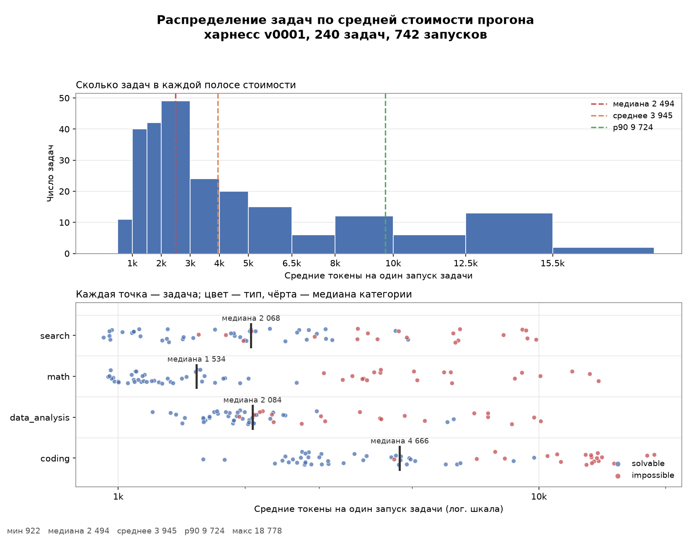

# OpenJiuwen Challenge 2026: харнесс кодового агента

Решение для соревнования
[OpenJiuwen Challenge 2026](https://techarena2026.ru/open-jiuwen-challenge).
Харнесс получает каталог задач и бюджет токенов, решает задачи агентом на
openJiuwen и сохраняет ответы и расход. В версии `0003` ответ агента — это
bash-скрипт в одном fenced-блоке: харнесс исполняет его в каталоге задачи и
читает `answer.txt`. По умолчанию используется модель без ризонинга.

**Кому читать.** README адресован организаторам и проверяющим: здесь сборка,
запуск, учёт расхода, обработка невыполнимых задач, траектории и неочевидные
детали. Точное текущее поведение и проверки — в
[specification/behavior/](specification/behavior/README.md).

## Коротко

| Вопрос | Ответ |
| --- | --- |
| Собрать образ | `docker build -t hack:latest .` |
| Запустить | команда регламента, см. [Сборка и запуск](#сборка-и-запуск) |
| Куда пишутся ответы | `answer.txt` в каталоге задачи; сводка — в `solutions.json` |
| Модель по умолчанию | `qwen3.6-35b-a3b-noreason`; переопределяется `--model` или `LLM_MODEL` |
| Как учитывается расход | `output + ceil(input / 10)` выходных токенов |
| Невыполнимые задачи | агент пишет `IMPOSSIBLE`; вторая волна может перепроверить задачу |
| Траектории | по флагу `--trajectories-dir`; оценщики пишут журнал bash-попыток в `data/trajectories/` |

## Сборка и запуск

```bash
docker build -t hack:latest .
```

Запуск — команда регламента:

```bash
mkdir -p "$OUT" && chmod 777 "$OUT"

timeout -k 1000s 1h docker run --rm --name "run-${TEAM}" \
  --network hack-net \
  -e LLM_BASE_URL -e LLM_API_KEY \
  -v "$TASKS:/data/tasks:rw" \
  --read-only --tmpfs /tmp:rw,size=2g -e HOME=/tmp \
  --cap-drop ALL --security-opt no-new-privileges \
  --cpus 8 --memory 16g --pids-limit 512 \
  --workdir /app --entrypoint python \
  "hack:latest" \
  /app/run_agent.py --tasks-dir /data/tasks
```

`TASKS`, `OUT`, `LLM_BASE_URL` и `LLM_API_KEY` передаёт проверяющая система.
Ключ живёт только в окружении и в образ не попадает. Если `OUT` не задан,
`solutions.json` пишется в каталог задач.

## Что происходит при запуске

1. Харнесс читает непосредственные подкаталоги `--tasks-dir`, в которых есть
   `task.json`. Порядок — лексикографический; баллы и сложность на порядок не
   влияют.
2. Перед первым ходом строится обзор рабочего каталога: `pwd`, `which python`,
   список файлов, заголовки датасетов, вывод найденных `test*.py` и текст
   задачи. Обзор ограничен по токенам.
3. **Волна 1.** Каждая задача получает один ход модели с лимитом 1000
   токенов. Модель возвращает один fenced-блок с bash-скриптом; харнесс
   исполняет его в рабочем каталоге. Если появился `answer.txt`, задача
   закрывается.
4. **Волна 2.** Незавершённые задачи ранжируются по ожидаемой пользе на
   токен. Перспективные получают ещё один ход с лимитом 4000 токенов и
   продолжают историю первой волны. `IMPOSSIBLE` можно перепроверить.
5. `solutions.json` перезаписывается атомарно после каждого хода. Поле
   `solved` означает «получен пригодный ответ»; корректность проверяют
   скрытые тесты.
6. Ошибка в одной задаче не останавливает прогон: она записывается с пометкой,
   и обработка продолжается. Состояние задачи сохраняется, поэтому повторный
   запуск процесса продолжает с того же места.

Задачи решаются последовательно; параллельные сессии не используются, хотя
регламент допускает до пяти. Модель фиксируется на весь прогон.

Подробности — в
[02_task_flow.md](specification/behavior/02_task_flow.md),
[03_solver.md](specification/behavior/03_solver.md) и
[05_answers_and_solutions.md](specification/behavior/05_answers_and_solutions.md).

## Учёт расхода

Стоимость вызова в выходных токенах:

```
cost = output_tokens + ceil(input_tokens / 10)
```

- Рассуждения входят в output; кеш провайдера не учитывается — все входные токены считаются полностью.
- Бюджет задаётся флагом `--budget` или переменными окружения; без бюджета лимита нет.
- Бюджет проверяется перед каждым ходом. Ход может превысить лимит на свою стоимость, но его результат уже сохраняется, после чего прогон останавливается.
- Расход восстанавливается из `solutions.json` при повторном запуске процесса.

**В харнессе пока эвристика, но предиктор уже обучен в research.** Вторая
волна ранжирует незавершённые задачи эвристикой по признакам первого хода;
обученная модель в зачётный код не интегрирована. Эксперименты
[0006](research/experiments/0006-predict-cost-before-solve.md) и
[0007](research/experiments/0007-predict-remaining-cost-during-solve.md)
показали: до решения стоимость предсказывается слабо (MAE на 4–8 % ниже
медианы категории на текущем харнессе), а после первого хода вероятность
правильного ответа предсказывается хорошо (ROC-AUC 0,901, Brier 0,127 на
240 свежих задачах). Входная стоимость следующего хода предсказывается почти
детерминированно (MAPE 4 %), выходная — нет. Артефакты лежат в
`research/experiments/0006-predict-cost-before-solve/results/`
(`cost_model.joblib`, `correct_model.joblib`, `predictor.json`). Текстовые
эмбеддинги и прямой вопрос LLM о стоимости не помогли
([0008](research/experiments/0008-text-vs-structural-features.md),
[0009](research/experiments/0009-llm-cost-probe.md)), а наивная перепроверка
отвеченных задач с низкой вероятностью не исправила ни одну из шести
([0010](research/experiments/0010-retry-low-confidence.md)).

Агенту бюджет не сообщается, чтобы он рассуждал о задаче, а не о расходе.
Подробности — в
[04_budget_and_selection.md](specification/behavior/04_budget_and_selection.md).

## Невыполнимые задачи

Поля `solvable` и `impossible` из `task.json` харнесс не читает: решение о
невыполнимости принимает агент. Если он записывает `IMPOSSIBLE` первой
строкой `answer.txt`, ответ сохраняется, но `solved=false`, и баллы не
начисляются. Вторая волна может перепроверить такую задачу, если эвристика
сочла её перспективной; при неудаче прежний ответ восстанавливается.

Это не оракул невыполнимости: агент может ошибиться в обе стороны. Оценщик
всё равно не начисляет баллы за задачи, помеченные как невыполнимые.
Подробности — в
[04_budget_and_selection.md](specification/behavior/04_budget_and_selection.md).

## Датасет задач

`data/task` — 240 задач в четырёх категориях (`coding`, `math`,
`data_analysis`, `search`), по 60 в каждой: 40 решаемых и 20 нерешаемых.
Решаемые проверяются через `unittest` (29), `hidden_unittest` (10),
`exact_int` (77) и `exact_str` (44). Сеть, GPU и внешние сервисы не нужны:
все данные лежат в `workspace/` задачи.

**Датасет сгенерирован агентами.** Задание агенту звучало так: придумать
задачи и сделать их разнообразными — менять тип данных, необходимые
инструменты, длину цепочки рассуждений и способ проверки, а не переставлять
числа в одном и том же условии. Вручную подготовлены только восемь примеров
организаторов, с которых началась генерация; остальные 232 задачи придуманы
агентами. Баллы `reward` перемешаны и не связаны с
категорией или сложностью, слов `easy`/`medium`/`hard` в условиях нет.
Устройство генератора — в
[data/task_generation/](data/task_generation/README.md), история партий — в
[data/task/journal.md](data/task/journal.md).

### Стоимость и число ходов

Стоимость измерена на прогонах харнесса v0001: в
[data/harness_task_score/harness_v_0001.tsv](data/harness_task_score/harness_v_0001.tsv)
1078 запусков, из них у 742 сохранены траектории. Ниже учитываются прогоны,
где есть и стоимость, и траектория. Средняя стоимость задачи (токены на один
запуск): медиана 2 494, среднее 3 945, 90-й процентиль 9 724, максимум
18 778 при минимуме 922. Распределение правостороннее: половина задач
укладывается в 2,5 тыс. токенов, но хвост тянется до 19 тыс.



Медианы по категориям различаются втрое: `coding` 4 666, `search` 2 068,
`data_analysis` 2 084, `math` 1 534 токена. Причина — не «дорогие» шаги, а
их количество. Ход — один LLM-шаг ReAct-цикла из траектории openJiuwen;
шаги посчитаны по тем же 742 прогонам с траекториями (`run_id` соединяет
YAML с датасетом).

| Категория | Медиана ходов | Медиана токенов | Токенов на ход |
| --- | ---: | ---: | ---: |
| coding | 7,0 | 4 666 | 678 |
| search | 4,0 | 2 068 | 565 |
| data_analysis | 3,3 | 2 084 | 620 |
| math | 2,3 | 1 534 | 624 |

Число ходов на задачу: медиана 4, среднее 5,0, разброс 2–12,3. Связь с
токенами почти линейная: Пирсон 0,93, Спирмен 0,96; после вычитания среднего
категории корреляция остаётся 0,93, то есть зависимость не сводится к
разнице между категориями. На ход тратится 565–678 токенов во всех
категориях, поэтому различия в стоимости объясняются числом ходов примерно на
86% дисперсии.


**Вывод:** стоимость решения задачи связана с числом ходов агента, а
категория влияет на неё лишь постольку, поскольку сдвигает типичное число
шагов. Предсказывать стоимость задачи разумнее по ожидаемому числу ходов, а
не по категории.

### v0002: bash-агент и волны

На `data/task_set/example.yaml` (8 задач) `harness_v0002` в четырёх прогонах
решил 8, 8, 7 и 6 задач и потратил 6,7–8,5 тыс. токенов. `harness_v0001`
решал те же 8 задач за 18–24 тыс. токенов. Разброс v0002 заметный: сложные
`search`-задачи решаются нестабильно. Это несколько прогонов, а не
статистически значимый замер; повторяемый план и сравнение по категориям — в
[research/experiments/0001-bash-agent-waves.md](research/experiments/0001-bash-agent-waves.md).

Стоимость v0002 ниже потому, что:

- системный промпт не содержит описания инструментов;
- обзор каталога строится один раз и ограничен по токенам;
- агент пишет один скрипт вместо цепочки инструментальных вызовов;
- после появления `answer.txt` дополнительные вызовы модели не делаются;
- вторая волна тратит токены только на перспективные задачи.

### v0003: модель без ризонинга и один блок

Эксперимент
[0003](research/experiments/0003-reasoning-models-and-explanations.md) на 32
задачах и четырёх прогонах показал, что формат ответа влияет сильнее выбора
модели:

- `NR → NR` с требованием «ровно один fenced-блок с полным скриптом» —
  89,75 ± 4,27 балла из 97 при 15 574 токенах;
- `R → R` — 86,50 ± 6,35 балла при 36 661 токене;
- разрешённый блок пояснений с извлечением «последнего блока» ломал
  исполнение, потому что модель дробила ответ на несколько блоков.

Поэтому в `0003`:

- модель по умолчанию — `qwen3.6-35b-a3b-noreason`;
- системный промпт требует ровно один fenced-блок с полным скриптом и
  запрещает текст до и после;
- `--model` и `LLM_MODEL` по-прежнему позволяют выбрать любую из четырёх
  моделей, включая reasoning-вариант.

## Траектории

Журнал попыток пишется только при тестовых прогонах и только по запросу:
харнессу передаётся `--trajectories-dir` (или `TRAJECTORIES_DIR`). Оценщики
делают это автоматически и складывают данные в `data/trajectories/`. Зачётный
запуск по регламенту флаг не передаёт, поэтому в контейнере ничего не
создаётся.

- `bash_attempts.jsonl` — одна JSON-строка на ход: задача, волна, обзор,
  рассуждение, ответ модели, скрипт, вывод, код возврата, расход и признаки
  сложности. Это источник истины для обучения предсказателя.
- `readable/<task_id>__waveN__<time>.yaml` — читаемая проекция той же записи.
- `task_id` совпадает с ключом в `solutions.json`. Оценщики передают
  `--run-id`; тот же `run_id` попадает в журнал и в строку
  `data/harness_task_score/` или `data/harness_task_set_score/`.
- Формат и пример чтения — в
  [data/trajectories/README.md](data/trajectories/README.md).
- Логи харнесса идут в stdout/stderr.
- В `solutions.json` в поле `note` фиксируются вид ответа, число ходов,
  вторая волна, `IMPOSSIBLE` и последняя ошибка.
- Оценщик сохраняет отчёты в `out/reports/*.json`.
- Артефакты агента и состояние задачи живут в
  `/tmp/agent-workspaces/<task_id>` и в контейнере исчезают вместе с ним.
- Канонические траектории `trajectories_default.jsonl` от `v0001` остаются
  как история, но `v0002` их не пишет.

Подробности — в
[06_trajectories.md](specification/behavior/06_trajectories.md).

## Неочевидные детали

- **Read-only корень.** Контейнер запускается с `--read-only`, поэтому всё изменяемое лежит в `/tmp` и в смонтированном каталоге задач. openJiuwen переводится в console-only режим до первого импорта SDK: иначе он пытается писать в `./logs` и падает.
- **Два `answer.txt`.** Регламент требует файл в каталоге задачи, а инструкции агенту — в текущем каталоге. Харнесс пишет оба, чтобы не зависеть от трактовки.
- **Остановка после ответа.** Как только после хода появился непустой `answer.txt`, новых вызовов модели в этой волне нет.
- **Скрипт лежит в рабочем каталоге.** Копия `.harness_step_NN.sh` создаётся рядом с файлами задачи, поэтому `dirname "$0"` не уводит агента в `/tmp`; после исполнения копия удаляется. Архивный скрипт остаётся в `/tmp/agent-workspaces/<task_id>/`.
- **Markdown-блоки.** Провайдер иногда кладёт рассуждения в `content` вместе с черновиками. Если в ответе есть блоки, исполняется последний; если блоков нет — ответ идёт в bash as-is.
- **Обзор не читает тяжёлые файлы.** Для датасетов читаются первые килобайты, длинные строки обрезаются, большие группы файлов сворачиваются в шаблоны, а найденные `test*.py` запускаются с таймаутом.
- **Бюджет не сообщается агенту.** В промптах нет остатка бюджета и слов `budget`/`tokens left`, чтобы модель не паниковала и рассуждала о задаче.
- **Состояние переживает перезапуск процесса.** `state.json` хранит обзор, историю, ходы и лучший ответ; задача продолжается, а не начинается заново.
- **`filelock` ниже 4.** openJiuwen не ограничивает `filelock` сверху, а с версией 4.x файловые инструменты падают. Ограничение зафиксировано в `harness/pyproject.toml`.
- **В образе нет `rg` и `git`.** Скрипты агента используют `grep`, `sed`, `awk`, `python3`; worktree-инструменты не используются.
- **Всё скачивается при сборке.** Базовый образ закреплён по digest, `uv` и зависимости — по версиям; при запуске сеть нужна только для прокси LLM. Локальных нейросетевых моделей, ключей и абсолютных путей разработчика в репозитории нет.

## Локальный запуск

```bash
cd harness
uv sync
export LLM_BASE_URL=... LLM_API_KEY=...
cp -R ../challenge_info/task-examples /tmp/tasks
uv run python -m harness.run_agent \
  --tasks-dir /tmp/tasks --out /tmp/out/solutions.json
uv run python -m unittest discover -s test
```

Сборку образа, размеры и прогон минимального набора задач проверяет
`python -m evaluation.dockerfile_checker`. Полное описание оценки, отчётов и
датасетов — в [evaluation/README.md](evaluation/README.md).

## Где искать детали

| Что нужно | Где смотреть |
| --- | --- |
| Требования организаторов и примеры задач | [challenge_info/](challenge_info/) |
| Текущее поведение и ограничения | [specification/behavior/](specification/behavior/README.md) |
| Версии харнесса, результаты замеров и траектории | [data/](data/) |
| Предсказание стоимости и модель | [research/experiments/0006-predict-cost-before-solve.md](research/experiments/0006-predict-cost-before-solve.md), [0007](research/experiments/0007-predict-remaining-cost-during-solve.md) |
| Инструменты оценки и отчёты | [evaluation/README.md](evaluation/README.md) |
| Правила разработки | [specification/constitution/](specification/constitution/README.md) |
