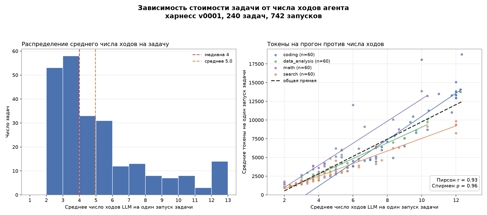

# OpenJiuwen Challenge 2026: харнесс кодового агента

Решение для соревнования
[OpenJiuwen Challenge 2026](https://techarena2026.ru/open-jiuwen-challenge).
Харнесс получает каталог задач и бюджет токенов, решает задачи агентом на
openJiuwen и сохраняет ответы и расход.

**Кому читать.** README адресован организаторам и проверяющим: здесь сборка,
запуск, учёт расхода, обработка невыполнимых задач, траектории и неочевидные
детали. Точное текущее поведение и проверки — в
[specification/behavior/](specification/behavior/README.md).

## Коротко

| Вопрос | Ответ |
| --- | --- |
| Собрать образ | `docker build -t hack:latest .` |
| Запустить | команда регламента, см. [Сборка и запуск](#сборка-и-запуск) |
| Куда пишутся ответы | `answer.txt` в каталоге задачи; сводка — в `solutions.json` |
| Как учитывается расход | `output + ceil(input / 10)` выходных токенов |
| Невыполнимые задачи | автоматически не распознаются |
| Траектории | по флагу `--trajectories-dir`; оценщики пишут JSONL и YAML в `data/trajectories/` |

## Сборка и запуск

```bash
docker build -t hack:latest .
```

Запуск — команда регламента:

```bash
mkdir -p "$OUT" && chmod 777 "$OUT"

timeout -k 1000s 1h docker run --rm --name "run-${TEAM}" \
  --network hack-net \
  -e LLM_BASE_URL -e LLM_API_KEY \
  -v "$TASKS:/data/tasks:rw" \
  --read-only --tmpfs /tmp:rw,size=2g -e HOME=/tmp \
  --cap-drop ALL --security-opt no-new-privileges \
  --cpus 8 --memory 16g --pids-limit 512 \
  --workdir /app --entrypoint python \
  "hack:latest" \
  /app/run_agent.py --tasks-dir /data/tasks
```

`TASKS`, `OUT`, `LLM_BASE_URL` и `LLM_API_KEY` передаёт проверяющая система.
Ключ живёт только в окружении и в образ не попадает. Если `OUT` не задан,
`solutions.json` пишется в каталог задач.

## Что происходит при запуске

1. Харнесс читает непосредственные подкаталоги `--tasks-dir`, в которых есть
   `task.json`. Порядок — лексикографический; баллы и сложность на порядок не
   влияют.
2. Каждую задачу решает отдельный `DeepAgent` из openJiuwen. Он работает в
   `workspace/` задачи (или в корне задачи, если `workspace/` нет) и вызывает
   инструмент `write_answer`.
3. `write_answer` пишет `answer.txt` в рабочий каталог и в корень задачи,
   после чего ReAct-цикл сразу завершается.
4. После каждой задачи `solutions.json` перезаписывается атомарно. Поле
   `solved` означает «ответ сдан»; корректность проверяют скрытые тесты.
5. Ошибка в одной задаче не останавливает прогон: она записывается с пометкой,
   и обработка продолжается.

Задачи решаются последовательно; параллельные сессии не используются, хотя
регламент допускает до пяти. Модель фиксируется на весь прогон.

Подробности — в
[02_task_flow.md](specification/behavior/02_task_flow.md),
[03_solver.md](specification/behavior/03_solver.md) и
[05_answers_and_solutions.md](specification/behavior/05_answers_and_solutions.md).

## Учёт расхода

Стоимость вызова в выходных токенах:

```
cost = output_tokens + ceil(input_tokens / 10)
```

- Рассуждения входят в output; кеш провайдера не учитывается — все входные токены считаются полностью.
- Бюджет задаётся флагом `--budget` или переменными окружения; без бюджета лимита нет.
- Бюджет проверяется перед задачей. Последняя задача может превысить лимит на свою стоимость, но её результат уже сохраняется, после чего прогон останавливается.

**Предварительной оценки стоимости нет.** Харнесс не оценивает задачу до
решения, не выбирает задачи по `reward` и идёт в порядке каталогов.
Подробности — в
[04_budget_and_selection.md](specification/behavior/04_budget_and_selection.md).

## Невыполнимые задачи

Автоматического распознавания нет: поля `solvable` и `impossible` из
`task.json` харнесс не читает и пытается решить все задачи. Оценщик не
начисляет баллы за задачи, помеченные как невыполнимые. Это главный разрыв с
целями соревнования; изменения оформляются отдельными спецификациями.

Подробности — в
[04_budget_and_selection.md](specification/behavior/04_budget_and_selection.md).

## Датасет задач

`data/task` — 240 задач в четырёх категориях (`coding`, `math`,
`data_analysis`, `search`), по 60 в каждой: 40 решаемых и 20 нерешаемых.
Решаемые проверяются через `unittest` (29), `hidden_unittest` (10),
`exact_int` (77) и `exact_str` (44). Сеть, GPU и внешние сервисы не нужны:
все данные лежат в `workspace/` задачи.

**Датасет сгенерирован агентами.** Задание агенту звучало так: придумать
задачи и сделать их разнообразными — менять тип данных, необходимые
инструменты, длину цепочки рассуждений и способ проверки, а не переставлять
числа в одном и том же условии. Вручную подготовлены только восемь примеров
организаторов, с которых началась генерация; остальные 232 задачи придуманы
агентами. Баллы `reward` перемешаны и не связаны с
категорией или сложностью, слов `easy`/`medium`/`hard` в условиях нет.
Устройство генератора — в
[data/task_generation/](data/task_generation/README.md), история партий — в
[data/task/journal.md](data/task/journal.md).

### Стоимость и число ходов

Стоимость измерена на прогонах харнесса v0001: в
[data/harness_task_score/harness_v_0001.tsv](data/harness_task_score/harness_v_0001.tsv)
1078 запусков, из них у 742 сохранены траектории. Ниже учитываются прогоны,
где есть и стоимость, и траектория. Средняя стоимость задачи (токены на один
запуск): медиана 2 494, среднее 3 945, 90-й процентиль 9 724, максимум
18 778 при минимуме 922. Распределение правостороннее: половина задач
укладывается в 2,5 тыс. токенов, но хвост тянется до 19 тыс.


Медианы по категориям различаются втрое: `coding` 4 666, `search` 2 068,
`data_analysis` 2 084, `math` 1 534 токена. Причина — не «дорогие» шаги, а
их количество. Ход — один LLM-шаг ReAct-цикла из траектории openJiuwen;
шаги посчитаны по тем же 742 прогонам с траекториями (`run_id` соединяет
YAML с датасетом).

| Категория | Медиана ходов | Медиана токенов | Токенов на ход |
| --- | ---: | ---: | ---: |
| coding | 7,0 | 4 666 | 678 |
| search | 4,0 | 2 068 | 565 |
| data_analysis | 3,3 | 2 084 | 620 |
| math | 2,3 | 1 534 | 624 |

Число ходов на задачу: медиана 4, среднее 5,0, разброс 2–12,3. Связь с
токенами почти линейная: Пирсон 0,93, Спирмен 0,96; после вычитания среднего
категории корреляция остаётся 0,93, то есть зависимость не сводится к
разнице между категориями. На ход тратится 565–678 токенов во всех
категориях, поэтому различия в стоимости объясняются числом ходов примерно на
86% дисперсии.



**Вывод:** стоимость решения задачи связана с числом ходов агента, а
категория влияет на неё лишь постольку, поскольку сдвигает типичное число
шагов. Предсказывать стоимость задачи разумнее по ожидаемому числу ходов, а
не по категории.

## Траектории

Полные траектории пишутся только при тестовых прогонах и только по запросу:
харнессу передаётся `--trajectories-dir` (или `TRAJECTORIES_DIR`). Оценщики
делают это автоматически и складывают данные в `data/trajectories/`. Зачётный
запуск по регламенту флаг не передаёт, поэтому в контейнере ничего не
создаётся.

- Сохраняется по одной канонической траектории openJiuwen на задачу
  (`data/trajectories/trajectories_default.jsonl`): вызовы инструментов,
  сообщения модели и её рассуждения.
- Рядом пишется читаемая YAML-проекция
  (`data/trajectories/readable/*.yaml`) с шагами модели и инструментов,
  рассуждениями, аргументами и результатами. JSONL остаётся источником истины
  для обучения, YAML удобен для просмотра глазами.
- Запись содержит `gen_ai.conversation.id` (в API — `session_id`), равный
  `task_id` из `task.json`; по этому значению она соединяется с
  `solutions.json`.
- Оценщики передают в харнесс `--run-id`; тот же `run_id` попадает в
  траекторию (JSONL-атрибут `harness.run_id`, YAML-поле `run_id`) и в строку
  `data/harness_task_score/`. Это связывает конкретную попытку решения с
  датасетом.
- Формат и пример чтения — в
  [data/trajectories/README.md](data/trajectories/README.md).
- Логи харнесса идут в stdout/stderr.
- В `solutions.json` в поле `note` фиксируется, как получен ответ и была ли
  ошибка.
- Оценщик сохраняет отчёты в `out/reports/*.json`.
- Артефакты агента живут в `/tmp/agent-workspaces/<task_id>` и в контейнере
  исчезают вместе с ним.

Подробности — в
[06_trajectories.md](specification/behavior/06_trajectories.md).

## Неочевидные детали

- **Read-only корень.** Контейнер запускается с `--read-only`, поэтому всё изменяемое лежит в `/tmp` и в смонтированном каталоге задач. openJiuwen переводится в console-only режим до первого импорта SDK: иначе он пытается писать в `./logs` и падает.
- **Два `answer.txt`.** Регламент требует файл в каталоге задачи, а инструкции агенту — в текущем каталоге. Харнесс пишет оба, чтобы не зависеть от трактовки.
- **Остановка после ответа.** `write_answer` принудительно завершает ReAct-цикл, чтобы не тратить лишний вызов модели.
- **`filelock` ниже 4.** openJiuwen не ограничивает `filelock` сверху, а с версией 4.x файловые инструменты падают. Ограничение зафиксировано в `harness/pyproject.toml`.
- **Без лишнего вызова модели.** Мультимодальное чтение изображений отключено: иначе агент тратит бюджет на фоновую проверку поддержки картинок.
- **Песочница агента — best-effort.** `SysOperation` блокирует абсолютные пути вне каталога задачи и workspace агента, но относительный выход через `..` не отлавливает. Контейнер дополнительно изолирован: read-only корень, `--cap-drop ALL`, `no-new-privileges`.
- **В образе нет `rg` и `git`.** `GrepTool` использует Python-fallback, worktree-инструменты не используются.
- **Всё скачивается при сборке.** Базовый образ закреплён по digest, `uv` и зависимости — по версиям; при запуске сеть нужна только для прокси LLM. Локальных нейросетевых моделей, ключей и абсолютных путей разработчика в репозитории нет.

## Локальный запуск

```bash
cd harness
uv sync
export LLM_BASE_URL=... LLM_API_KEY=...
cp -R ../challenge_info/task-examples /tmp/tasks
uv run python -m harness.run_agent \
  --tasks-dir /tmp/tasks --out /tmp/out/solutions.json
uv run python -m unittest discover -s test
```

Сборку образа, размеры и прогон минимального набора задач проверяет
`python -m evaluation.dockerfile_checker`. Полное описание оценки, отчётов и
датасетов — в [evaluation/README.md](evaluation/README.md).

## Где искать детали

| Что нужно | Где смотреть |
| --- | --- |
| Требования организаторов и примеры задач | [challenge_info/](challenge_info/) |
| Текущее поведение и ограничения | [specification/behavior/](specification/behavior/README.md) |
| Версии харнесса, результаты замеров и траектории | [data/](data/) |
| Инструменты оценки и отчёты | [evaluation/README.md](evaluation/README.md) |
| Правила разработки | [specification/constitution/](specification/constitution/README.md) |
