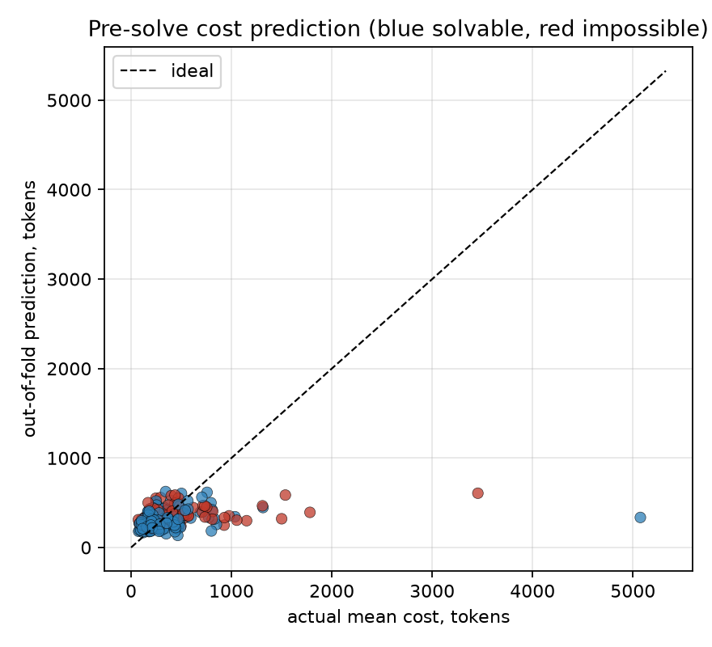

# 0006. Стоимость задачи до решения по статическим признакам

- Статус: done
- Дата: 2026-11-13
- Харнесс: `0003`
- Связанная спецификация: — (по результату, возможно,
  `specification/changes/NNNN-cost-predictor/`)
- Артефакты: `research/experiments/0006-predict-cost-before-solve/`
  (`static_features.py`, `collect_costs.py`, `train_static.py`,
  `finalize_static.py`, `classify_static.py`, `results/`)

## Гипотеза

Цель соревнования — не только решать задачи дёшево, но и **до решения**
понимать, сколько токенов задача потребует и стоит ли она этих токенов.
Литература ([обзор 0001](../literature_review/0001-priori-task-difficulty/))
говорит, что лучше всего работают структурные признаки условия, а не длина
текста и не прямой вопрос сильной модели; готового переносимого предиктора
для агентского кода при общем бюджете нет.

Проверяем три утверждения.

1. **Стоимость предсказуема до решения.** По признакам, доступным до первого
   вызова модели (текст инструкции, файлы workspace, категория, `reward`),
   можно предсказать логарифм стоимости задачи заметно лучше, чем медиана по
   категории. Основной сигнал — не длина условия, а объём и структура работы:
   число файлов, строк данных, наличие тестов, число шагов в условии.
2. **Предсказание переносится на новую категорию и новый блок задач.**
   Прирост сохраняется при leave-one-category-out и leave-one-id-block-out, а
   не только при случайном разбиении. Статические признаки не должны
   кодировать метку `solvable`/`impossible` через служебные поля `task.json`.
3. **Выполнимость предсказуема отдельно от стоимости,** но качество честного
   классификатора (без полей `solvable`, `check`, `expected`) ниже, чем у
   классификатора, который видит эти поля. Разница измеряет утечку
   синтетического генератора.

Гипотеза подтверждается, если на отложенных задачах:

- регрессия логарифма стоимости даёт Spearman ≥ 0,55 и снижает MAE не менее
  чем на 15 % относительно медианы по категории;
- прирост сохраняется при leave-one-category-out и leave-one-id-block-out;
- классификатор выполнимости без служебных полей даёт ROC-AUC ≥ 0,70;
- на 8 задачах организаторов (внешний набор) ранговая корреляция
  предсказанной и фактической стоимости ≥ 0,50 — ориентир, а не строгий
  критерий из-за размера выборки.

Гипотеза опровергается, если модели не лучше медианы по категории или если
весь прирост объясняется служебными полями `task.json`.

## Условия

- Модель: `qwen3.6-35b-a3b-noreason`, волны 1000/4000 токенов,
  `--wave2-max-tasks 0` (вторая волна для всех незакрытых задач), без
  бюджета.
- Данные:
  - **основная цель** — свежий прогон текущего харнесса `0003` по всем 240
    задачам `data/task`, 2 повтора; стоимость задачи — сумма всех ходов;
  - **проверка переноса версии** — исторический `harness_v_0001.tsv`
    (5 повторов на задачу, старый промпт и инструментальный агент);
  - **разбиение по генератору** — блоки `task_id`: примеры организаторов
    (`0001–0002`), первые сгенерированные (`0003–0006`), ручные
    невыполнимые (`0101–0110`, `0111–0120`), массовая генерация
    (`0201–0240`), поздняя генерация (`0301–0340`). Блок определяется
    номером в `task_id`, а не категорией;
  - **внешний набор** — 8 задач `challenge_info/task-examples`, 1 повтор,
    стоимость измеряется тем же харнессом. Все они решаемые; для регрессии
    этого достаточно, для классификатора — нет.
- Признаки (только доступные до первого хода):
  - инструкция: длина, слова, предложения, числа, цифры, обратные кавычки,
    имена файлов, группы глаголов (найти/посчитать/исправить/проверить),
    число шагов и союзов, длина без общего boilerplate-суффикса;
  - workspace: число файлов и каталогов, суммарные байты и строки, максимум
    по файлу, расширения, число тестов, строки CSV/JSONL, число колонок,
    глубина вложенности, доля текстовых файлов;
  - метаданные: категория и `reward`.
  - **Исключены из честной модели:** `solvable`, `check`, `expected`,
    `task_id`, порядковый номер задачи в каталоге. Отдельная «модель с
    утечкой» видит `check` и `expected`, чтобы измерить, сколько качества
    даёт служебная разметка.
- Модели: Ridge на `log(cost)`, RandomForest, HistGradientBoosting.
  Гиперпараметры выбираются внутри train/validation, test не используется.
  Baseline: глобальная медиана, медиана по категории, линейная регрессия
  только по длине инструкции, только по `workspace bytes`.
- Разбиения:
  - GroupKFold по задаче (повторы одной задачи не расщепляются);
  - leave-one-category-out (4 ротации);
  - leave-one-id-block-out;
  - внешний набор организаторов.
- Метрики: MAE, RMSE, R², Spearman на исходной и логарифмической шкале;
  для классификации — ROC-AUC, PR-AUC, Brier, accuracy, калибровка.
  Доверительные интервалы — bootstrap по задачам.

### Команды

```bash
# 1. Один повтор текущего харнесса (две волны, без лимита wave2).
LLM_BASE_URL=... LLM_API_KEY=... harness/.venv/bin/python \
  research/experiments/0006-predict-cost-before-solve/collect_costs.py \
  --reps 1 --shards 2 --skip-examples

# 2. Собрать current_runs.csv из work-каталога.
harness/.venv/bin/python \
  research/experiments/0006-predict-cost-before-solve/assemble_runs.py \
  --work-root /tmp/pred0006 --rep 100 --out .../results/current_runs.csv

# 3. Признаки задачи и обзора.
harness/.venv/bin/python \
  research/experiments/0006-predict-cost-before-solve/static_features.py \
  --tasks-dir data/task --out .../results/static_features.csv
harness/.venv/bin/python \
  research/experiments/0007-predict-remaining-cost-during-solve/build_turn_dataset.py
harness/.venv/bin/python \
  research/experiments/0006-predict-cost-before-solve/overview_features.py \
  --groups .../0007-.../results/turn_groups.csv --out .../results/overview_features.csv

# 4. Метрики и модель.
harness/.venv/bin/python .../train_static.py   # полный свип (медленно)
harness/.venv/bin/python .../finalize_static.py
harness/.venv/bin/python .../classify_static.py

# 5. Внешние 8 задач организаторов.
# (копируются в /tmp/pred_examples по структуре category/label/number)
LLM_BASE_URL=... LLM_API_KEY=... harness/.venv/bin/python \
  research/experiments/0006-predict-cost-before-solve/collect_costs.py \
  --tasks-dir /tmp/pred_examples --reps 1 --shards 1 --skip-examples
```

## Результат

Свежий прогон: 240 задач × 1 повтор (харнесс `0003`,
`qwen3.6-35b-a3b-noreason`, волны 1000/4000, `--wave2-max-tasks 0`). Один
повтор, потому что провайдер ограничивает одновременные запросы и повторные
прогоны шли слишком медленно; 240 задач достаточно для кросс-валидации по
задачам. Сырые данные — `results/current_runs.csv`,
`results/static_report.json`, `results/classification_report.json`,
`results/example_runs.csv`.

| Величина | Значение |
| --- | ---: |
| Стоимость задачи: медиана / среднее | 295,5 / 397 токенов |
| Правильных ответов | 134 / 240 = 55,8 % |
| Решаемых задач зачтено | 134 / 160 = 83,8 % |
| Ответ в первой волне | 152 / 240 = 63,3 % |
| Медиана стоимости `solvable` / `impossible` | 257,5 / 372,5 |

### Стоимость: текущий харнесс `0003`

MAE на отложенных задачах, меньше — лучше; Spearman — ранговая корреляция.

| Разбиение | Baseline (медиана категории) | RandomForest | Δ MAE | Spearman baseline → RF |
| --- | ---: | ---: | ---: | ---: |
| random | 204,3 | 188,4 | −7,8 % | 0,036 → 0,422 |
| leave-category-out | 205,3 | 197,2 | −4,0 % | −0,137 → 0,289 |
| leave-block-out | 227,7 | 211,1 | −7,3 % | −0,341 → 0,149 |

Bootstrap по задачам для random: MAE 188,4, 95 % CI [145,9; 257,3];
Spearman 0,422, CI [0,317; 0,520].



Модель сжимает прогноз: большинство задач с фактической стоимостью 100–800
токенов предсказаны в диапазоне 100–600, а редкие дорогие прогоны (3 300 и
5 200 токенов) недооценены. Для бюджета это означает, что хвост риска
нужно покрывать запасом, а не доверять точечной оценке.

Классификация на терцили стоимости (дёшево / средне / дорого) не меняет
картину: accuracy 0,512 на random, 0,358 на leave-category-out, 0,388 на
leave-block-out при majority 0,333. То есть и регрессия, и кубиты
переносятся слабо.

Главный вывод по стоимости: **на текущем харнессе абсолютная стоимость
предсказывается слабо**. Модель выигрывает у медианы категории на 4–8 %
MAE, но это меньше порога 15 %, а Spearman 0,42 ниже 0,55. Ранжирование
улучшается (знак корреляции меняется с отрицательного на положительный), но
для выбора задач этого мало.

### Стоимость: исторический `v0001` и `exp0002`

| Цель | Разбиение | Baseline MAE | RF MAE | Δ MAE | Spearman baseline → RF |
| --- | --- | ---: | ---: | ---: | ---: |
| v0001 | random | 2 122,0 | 1 455,6 | −31,4 % | 0,401 → 0,748 |
| v0001 | category | 2 524,7 | 2 238,0 | −11,4 % | −0,346 → 0,339 |
| v0001 | block | 4 030,1 | 2 593,3 | −35,7 % | −0,256 → 0,241 |
| exp0002, wave 1 | random | 506,9 | 468,6 | −7,6 % | 0,094 → 0,393 |

На старом, дорогом `v0001` структурные признаки работают заметно лучше:
MAE падает на 11–36 %, ранговая корреляция 0,24–0,75. Причина в том, что
там стоимость сильно зависит от объёма работы (файлы, тесты, длина условия),
а в `0003` — от того, сколько токенов модель потратит на один скрипт, что
слабо связано с условием.

### Решаемость и невыполнимость до решения

| Цель | Разбиение | ROC-AUC | PR-AUC |
| --- | --- | ---: | ---: |
| `impossible` | random | 0,990 | 0,978 |
| `impossible` | leave-category-out | 0,920 | 0,855 |
| `impossible` | leave-block-out | 0,317 | 0,244 |
| `correct` | random | 0,929 | 0,916 |
| `correct` | leave-category-out | 0,774 | 0,757 |
| `correct` | leave-block-out | 0,322 | 0,486 |
| `answered wave 1` | random | 0,839 | 0,865 |
| `answered wave 1` | leave-category-out | 0,479 | 0,612 |
| `answered wave 1` | leave-block-out | 0,551 | 0,663 |

Классификатор с «утечкой» (поля `check`, `has_expected`,
`has_solvable_field`) даёт ROC-AUC 1,000 на всех разбиениях: в синтетическом
датасете `check: "none"` и `solvable: false` — идеальный оракул. Поэтому
честная модель без этих полей — единственная допустимая.

Честная модель хорошо разделяет классы **внутри категории** (AUC 0,92) и
разваливается при переносе на новый блок генератора (AUC 0,32). Это не
случайный шум: блоки `0101–0200` и `0301–0400` состоят только из
невыполнимых задач, а `0201–0300` — только из решаемых, поэтому
leave-block-out проверяет перенос между разными партиями генератора.
Признаки, которые выучиваются, — длина условия, число файлов, слова
`modify`/`inspect`, — отражают стиль партии, а не общее свойство
невыполнимости. Предсказать «будет ли ответ в первой волне» до решения
нельзя (AUC 0,48–0,55 на честных разбиениях).

### Внешний набор организаторов

8 задач `challenge_info/task-examples` (те же, что `data/task/*/solvable/0001–0002`)
прогнаны текущим харнессом: стоимость 104–368 токенов. Модель, обученная на
остальных 232 задачах, предсказывает 288–471 токен и переоценивает
`data_analysis`, `math` и `search` в 2–4 раза.

| Метрика | RF | Медиана категории |
| --- | ---: | ---: |
| MAE | 192 | 86 |
| Spearman | 0,238 | — |

Абсолютная калибровка на задачи организаторов **не переносится**; медиана
категории на этих восьми задачах лучше. Ранжирование тоже слабое. Это
означает, что статический предиктор нельзя использовать как единственный
селектор на скрытом наборе без калибровки на нескольких реальных задачах.

### Важность признаков

Топ-10 для стоимости: `ins_chars_raw`, `ins_words_raw`, `ins_avg_word_len`,
`ins_kw_modify_per100`, `reward`, `ins_uppercase_ratio`, `overview_chars`,
`ins_kw_inspect_per100`, `ws_test_bytes`, `ins_chars`. То есть длина условия,
доля «модифицирующих» слов, длина обзора и размер тестов. `reward` попадает в
топ, хотя размечен случайно; это шум, а не сигнал.

### Двухстадийная модель

`P(ответ в волне 1) × E[стоимость волны 1 | ответ] +
(1 − P) × E[стоимость | нет ответа]` даёт MAE 228,9 и Spearman 0,183 —
хуже прямого RandomForest (188,4 / 0,422). Декомпозиция не помогает:
неопределённость в `P(ответ)` и в стоимости unanswered-задачи больше, чем
выигрыш от интерпретируемости. Прямая модель остаётся основной.

### Ограничения

- Собран **один повтор** на 240 задач, а не три: прокси ограничивает
  одновременные запросы, а повторные проходы шли слишком медленно. Один
  повтор на задачу достаточно для кросс-валидации по задачам, но не
  позволяет отделить шум прогона от свойства задачи.
- Восемь задач организаторов — это те же `data/task/*/solvable/0001–0002`,
  а не независимый набор. Они исключены из обучения, но всё равно относятся
  к тому же формату и категориям; перенос на скрытый набор строже.
- Синтетический датасет сгенерирован агентами; блоки `task_id` отражают
  партии генератора. Leave-block-out — единственная честная проверка
  переноса между партиями, и на ней классификатор решаемости падает.
- Модель обучена на `data/task`; для скрытого набора нужна калибровка на
  нескольких реальных задачах. Без неё абсолютная стоимость смещена.

## Вывод

Гипотеза подтверждена **частично и только для старого харнесса**.

1. **Стоимость до решения предсказуема слабо на текущем харнессе.** MAE
   ниже медианы категории на 4–8 %, Spearman 0,15–0,42. Порог 15 % / 0,55
   не достигнут. Ранжирование улучшается, абсолютная калибровка — нет.
2. **На `v0001` сигнал сильнее:** −11…−36 % MAE, Spearman 0,24–0,75. Это
   объяснимо: там стоимость определяется объёмом работы, а не длиной одного
   скрипта. Переносить вывод на `0003` нельзя.
3. **Решаемость до решения не переносится на новый блок генератора.**
   Внутри категории AUC 0,92, на новом блоке — 0,32. Служебные поля
   `check`/`solvable` дают AUC 1,0, то есть синтетическая разметка
   тривиально кодируется метаданными. Честный классификатор не готов к
   скрытому набору.
4. **Внешние задачи организаторов переоцениваются в 2–4 раза**; медиана
   категории бьёт модель по MAE. Без калибровки на реальных задачах
   статический предиктор нельзя ставить в бюджетный планировщик.
5. **«Ожидаемое число ходов» до решения не предсказывается:** AUC 0,48–0,55
   на честных разбиениях. Число ходов определяется поведением модели на
   первом ходу, а не условием.

## Решение

1. Сохранить статическую модель как **грубый априорный prior** для
   ранжирования, но не как абсолютную оценку стоимости. Артефакты:
   `results/cost_model.joblib`, `results/impossible_model.joblib`,
   `results/correct_model.joblib`, `results/linear_cost_model.json`,
   `results/predictor.json`. Перед использованием на скрытом наборе нужна
   калибровка на 3–5 реальных задачах (сдвиг/масштаб по логу стоимости).
2. Не использовать статический классификатор невыполнимости как
   самостоятельный фильтр: на новом блоке он хуже случайного. Оставить его
   только как признак для ансамбля с онлайн-сигналом.
3. Основную ставку делать на **онлайн-предсказание после первого хода**
   (эксперимент `0007`): там стоимость первого хода уже известна, а
   вероятность успеха предсказывается с AUC 0,856 на свежих задачах.
4. Начать с малого: первый ход стоит 100–300 токенов, поэтому
   «предсказание в процессе» дешевле и надёжнее, чем попытка угадать
   стоимость до решения.
5. Для интеграции позже: использовать статическую модель только для
   начальной сортировки задач и для оценки «сколько осталось бюджета на
   попытки», а решение о второй волне принимать по онлайн-модели.
