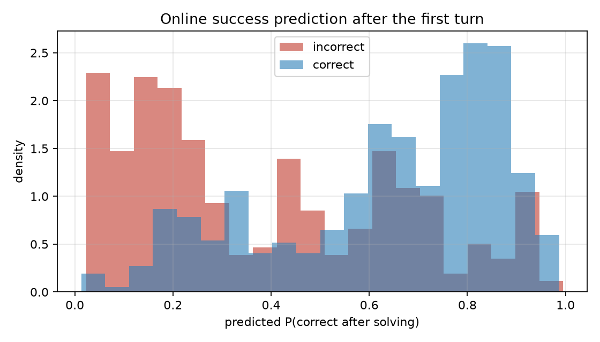

# 0007. Остаток стоимости и вероятность успеха по ходу решения

- Статус: done
- Дата: 2026-11-13
- Харнесс: `0003`
- Связанная спецификация: — (по результату, возможно,
  `specification/changes/NNNN-online-predictor/`)
- Артефакты: `research/experiments/0007-predict-remaining-cost-during-solve/`
  (`build_turn_dataset.py`, `train_online.py`, `budget_simulation.py`,
  `finalize_online.py`, `results/`)

## Гипотеза

Априорная оценка (эксперимент `0006`) ограничена: условие и файлы не
показывают, что именно модель сделает на первом ходу. Зато после первого
хода известен уже потраченный контекст, форма скрипта, вывод, код возврата и
вид ответа. Проверяем, что этого достаточно, чтобы **во время решения**
предсказать:

1. **Стоимость следующего хода.** Входная часть почти детерминирована:
   следующий контекст = прошлый контекст + ответ модели + сообщение с выводом
   скрипта. Выходная часть зависит от того, что модель собирается написать.
   Гипотеза: `input_tokens` следующего хода предсказывается с MAPE ≤ 10 %, а
   стоимость хода (`output + ceil(input/10)`) — с MAPE ≤ 25 %.
2. **Остаток стоимости задачи.** После первого хода ожидаемый остаток =
   вероятность второго хода × ожидаемая стоимость второго хода. Гипотеза:
   MAE остатка лучше константы (медианы) не менее чем на 25 %.
3. **Вероятность правильного ответа.** По признакам первого хода
   (вид ответа, код возврата, длина и форма скрипта, вывод, тесты, категория,
   расход) вероятность того, что ответ будет зачтён, предсказывается лучше,
   чем правило «есть ответ → решено». Критерий: ROC-AUC ≥ 0,80 и выше
   AUC правила «answer_present».
4. **Вероятность невыполнимости.** Отдельный классификатор
   `impossible` по тем же признакам даёт ROC-AUC ≥ 0,80. Это нужно, чтобы не
   тратить вторую волну на задачи, где модель уже нашла противоречие.
5. **Правило выбора второй волны.** Если заменить эвристику `promise_score`
   на ожидаемую выгоду `P(успех) × reward − стоимость`, на отложенных задачах
   отношение «баллы / токены» не падает. Это проверяется офлайн по
   залогированным исходам, без изменения харнесса.

Гипотеза подтверждается, если пункты 1–4 выполняются на отложенных задачах,
а правило 5 не ухудшает балл при том же бюджете. Если предсказание
вероятности работает, но правило выбора — нет, это всё равно полезный
результат: модель даёт сигнал, а политику нужно настраивать отдельно.

## Условия

- Модель: `qwen3.6-35b-a3b-noreason`, волны 1000/4000 токенов.
- Данные:
  - `exp0002` — 240 задач, только первая волна, известна правильность
    ответа (`results/correctness.json` из `0002`). Основной набор для
    классификаторов после первого хода.
  - свежий прогон `0006` — 240 задач × 3 повтора, две волны, правильность
    проверена `answer_evaluator`. Основной набор для стоимости следующего
    хода и остатка.
  - `0003/0004/0005` — 32 задачи, много повторов, две волны; используется
    как независимый набор для проверки переноса между версиями промпта.
  - `harness_v_0001.tsv` — историческая стоимость, только для проверки
    переноса априорной модели.
- Признаки первого хода: `input_tokens`, `output_tokens`, `cost`,
  длина/строки скрипта, флаги `script_has_python/tests/file_ops/write_answer`,
  `script_mentions_impossible`, `reasoning_*`, `hit_token_limit`,
  `exit_code`, `script_timed_out`, `output_chars`, `answer_kind`,
  `answer_chars`, длина обзора, `tests_in_overview`, `task_type`, `reward`.
  Для стоимости следующего хода дополнительно: `prev_input + prev_output`,
  длина вывода скрипта, длина предупреждения второй волны.
- Цели:
  - `next_input_tokens`, `next_output_tokens`, `next_cost`;
  - `remaining_cost` (все ходы после первого), `total_cost`;
  - `correct` (вердикт оценщика), `impossible` (метка каталога),
    `answered` (вид ответа `done`/`value`).
- Разбиения: GroupKFold по задаче (повторы не расщепляются);
  leave-one-category-out; проверка на другом наборе/версии (обучение на
  `exp0002`, тест на свежем `0006`, и наоборот).
- Модели: Ridge/HistGradientBoosting для регрессии,
  LogisticRegression/RandomForest/HistGradientBoosting для классификации.
  Гиперпараметры — на внутренней validation, test не используется.
- Метрики: MAE, MedAE, MAPE, R², Spearman; ROC-AUC, PR-AUC, Brier, log-loss,
  accuracy, калибровка (ECE); для правила выбора — балл, стоимость,
  баллы/1k токенов, доля потраченных впустую токенов.
- Правило выбора: для каждой задачи после первой волны считаем
  `P(успех второй волны)` (отдельная модель или `P(correct)`), ожидаемую
  стоимость второй волны и запускаем вторую волну, если
  `P × reward > λ × cost`. Сравниваем с текущим `promise_score` при
  одинаковом бюджете; λ подбирается на validation.

### Команды

```bash
# 1. Собрать turn-level датасет (свежий прогон 0006 + старые траектории).
harness/.venv/bin/python \
  research/experiments/0007-predict-remaining-cost-during-solve/build_turn_dataset.py \
  --fresh-root /tmp/pred0006 \
  --fresh-pattern 'rep100/shard*/work/traj/bash_attempts.jsonl'

# 2. Метрики и out-of-fold предсказания.
harness/.venv/bin/python \
  research/experiments/0007-predict-remaining-cost-during-solve/train_online.py

# 3. Модель для интеграции и бюджетная симуляция на свежих задачах.
harness/.venv/bin/python \
  research/experiments/0007-predict-remaining-cost-during-solve/finalize_online.py
harness/.venv/bin/python \
  research/experiments/0007-predict-remaining-cost-during-solve/budget_simulation.py \
  --policy .../results/online_fresh_predictions.csv \
  --out .../results/budget_report_fresh.json
```

## Результат

Данные: 1 290 групп «прогон × задача» (240 свежих задач `0006` и 1 050
повторов 32 задач из `0003/0004/0005`) и 466 пар «первый → второй ход».
Сырые данные — `results/turn_groups.csv`, `results/turn_pairs.csv`,
`results/online_report.json`, `results/budget_report.json`,
`results/policy_tasks.csv`.

### Стоимость следующего хода

| Цель | Модель | MAE | MAPE | R² | Spearman |
| --- | --- | ---: | ---: | ---: | ---: |
| `next_input` | Ridge | **32,9** | **3,96 %** | **0,958** | **0,991** |
| `next_input` | формула | 62,3 | — | — | — |
| `next_input` | медиана | 298 | — | — | — |
| `next_output` | RF | 293,8 | 4,74 | 0,024 | 0,510 |
| `next_output` | медиана | 307 | — | — | — |
| `next_cost` | RF | 292,6 | 3,02 | 0,062 | 0,582 |
| `next_cost` | медиана | 320 | — | — | — |
| `next_cost` | правило по `answer_kind` | 319,7 | — | — | — |

**Входная часть следующего хода предсказывается почти детерминированно:**
Ridge на `prev_input + prev_output + длина вывода скрипта` даёт MAPE 3,96 % и
R² 0,958. Выходная часть (сколько токенов модель напишет) непредсказуема:
RF лишь на 4 % лучше медианы по `next_output` и на 9 % по `next_cost`.
Практический вывод: стоимость следующего хода можно оценить как
`известный вход + константа на выход`, не обучая сложную модель.

### Остаток и полная стоимость после первого хода

| Цель | Модель | MAE | R² | Spearman |
| --- | --- | ---: | ---: | ---: |
| `remaining_cost` (467 unanswered) | RF | 303,1 | 0,021 | 0,567 |
| `remaining_cost` (467 unanswered) | медиана | 320,0 | — | — |
| `total_cost` (все группы) | HGB | 133,8 | 0,523 | — |
| `total_cost` (все группы) | `cost1 + медиана остатка` | **116,0** | — | — |

Остаток стоимости **не предсказывается по величине**: RF выигрывает у
медианы 5 %, R² около нуля. Полная стоимость после первого хода лучше всего
описывается правилом `известный cost1 + константа 288`, а не моделью
(116 против 133,8 MAE). На свежих задачах константа равна 230, MAE правила
79. Это не неудача: `cost1` уже известен, а неопределённость в остатке
невелика и не зависит от признаков.

### Вероятность правильного ответа после первого хода

| Набор | n | Base rate | AUC модели | AUC правила «есть ответ» | Brier модели | Brier константы |
| --- | ---: | ---: | ---: | ---: | ---: | ---: |
| свежие `0006`, 5-fold по задачам | 240 | 0,558 | **0,901** | 0,771 | **0,127** | 0,247 |
| модель со смеси, перенос на свежие | 240 | 0,558 | 0,856 | 0,771 | 0,151 | 0,247 |
| 32 задачи `0003–0005` | 1 050 | 0,595 | 0,735 | 0,770 | 0,210 | 0,241 |
| всё вместе | 1 290 | 0,588 | 0,761 | 0,770 | 0,199 | 0,242 |

На свежих задачах модель **лучше правила «есть ответ → решено»** на 0,130
AUC, хорошо калибрована (средняя предсказанная 0,560 при фактической 0,558,
ECE 0,061) и почти вдвое снижает Brier. Модель, обученная на смеси, при
переносе на свежие даёт 0,856 AUC и 0,151 Brier — тоже лучше правила, но
хуже специализированной модели.



Разделение заметно: верные исходы смещены к высоким вероятностям, неверные —
к низким. Пересечение в середине и есть та неопределённость, из-за которой
нельзя обойтись одним порогом. На старых 32 задачах (много конфигураций
промпта, повторы) модель не лучше правила. Это ожидаемо: там 32 задачи и
1 050 коррелированных наблюдений, а не 240 независимых задач.

Внутри отвеченных задач модель тоже различает верные и неверные ответы:
AUC 0,757 на свежих. При пороге `P < 0,2` на свежих задачах 6 из 6 ответов
неверны; при `P < 0,3` — 8 из 8; при `P < 0,4` — 8 из 9 (89 %). Средняя
доля неверных среди отвеченных — 23 %. Это готовый сигнал для перепроверки:
текущий харнесс никогда не перепроверяет задачу с непустым `answer.txt`.

### Невыполнимость после первого хода

Отдельный классификатор `impossible` по признакам первого хода на смешанных
данных даёт ROC-AUC 0,53 (PR 0,42), то есть почти случайно. Причина: модель
уже видит `answer_kind`, а невыполнимость в основном выражается через
`correct`, который предсказывается лучше. Отдельный классификатор
невыполнимости не нужен; вероятность успеха его заменяет.

### Выбор второй волны при бюджете

Симуляция на свежих 240 задачах: 88 unanswered-попыток, бюджет — доля
фактического остатка (31 238 токенов). Политика `model` сортирует по
`P(успех) × reward / ожидаемый остаток`, `promise` — прокси текущей
эвристики `reward / (cost1 + 4000)`, `always` — в порядке задач, `oracle` —
по фактической выгоде.

| Бюджет | model, баллы/1k | promise | always | oracle |
| --- | ---: | ---: | ---: | ---: |
| 10 % | **13,08** | 7,38 | 0,00 | 24,06 |
| 25 % | **5,12** | 4,79 | 1,55 | 10,95 |
| 50 % | **4,43** | 3,54 | 2,43 | 5,46 |
| 75 % | **3,37** | 2,95 | 2,52 | 3,64 |
| 100 % | 2,72 | 2,72 | 2,72 | 2,72 |

При 10 % бюджета модель даёт почти вдвое больше баллов на 1k токенов, чем
текущая эвристика; при 25–75 % — на 7–25 %. На полном бюджете различий нет,
потому что запускаются все задачи. `always` (порядок задач) на 10 % бюджета
не приносит баллов вообще: первые задачи в порядке файла оказываются
неудачными.
`cheapest` (сортировка по стоимости) на 10 % даёт 2,25, на 25 % — 4,38, то
есть модель лучше и там. Это офлайн-симуляция на залогированных исходах, а
не интегрированный прогон.

## Вывод

Гипотеза подтверждена частично, и главный результат — не там, где ожидался.

1. **Входная стоимость следующего хода предсказуется почти идеально**
   (MAPE 3,96 %, R² 0,958). Это позволяет точно знать, сколько будет стоить
   контекст следующего вызова, ещё до его выполнения.
2. **Выходная часть и остаток стоимости не предсказуются.** Модель для
   `next_output` и `remaining_cost` не лучше медианы/константы. Полную
   стоимость после первого хода лучше оценивать правилом
   `cost1 + константа`, а не регрессией.
3. **Вероятность успеха — сильная сторона.** На 240 свежих задачах AUC 0,901,
   Brier 0,127, ECE 0,061, калибровка почти идеальная. Модель лучше правила
   «есть ответ» и находит подмножество отвеченных задач с высокой долей
   ошибок (6 из 6 при `P < 0,2`, 8 из 8 при `P < 0,3`).
4. **Отдельный классификатор невыполнимости не нужен:** AUC 0,53, а
   `P(correct)` уже содержит этот сигнал.
5. **Правило выбора по `P(correct)` выигрывает у текущей эвристики** в
   бюджетной симуляции: +77 % баллов/1k при 10 % бюджета, +7 % при 25 %,
   +25 % при 50 %, +14 % при 75 %. Это верхняя оценка: решение принимается
   офлайн по залогированным исходам, а не в живом прогоне.

### Ограничения

- Свежие данные — один повтор на 240 задач (ограничение прокси), старые
  1 050 строк — 32 задачи с разными конфигурациями промпта. Поэтому
  основная метрика классификатора — fresh-only; смешанная выборка
  занижает AUC из-за коррелированных повторов.
- Бюджетная симуляция использует залогированные исходы второй волны. Если
  политика пропускает задачу, её фактический исход неизвестен; для
  пропущенных задач балл считается нулевым, а стоимость — только первый ход.
  Это консервативно для пропуска, но не проверяет, что задача осталась бы
  нерешённой при повторе.
- Перепроверка отвеченных задач с низким `P(correct)` проверена только
  пилотом `0010`: 0 исправлений из 6, поэтому политика «повторить всё с
  низкой вероятностью» не подтверждена. Оценка «6 из 6 неверны при
  `P < 0,2`» — это доля ошибок, а не доля исправлений.
- Модель обучалась на синтетических задачах; вероятности могут сдвинуться
  на скрытом наборе. Нужна калибровка на нескольких реальных прогонах.

## Решение

1. В харнесс (отдельным изменением) ставить не регрессию остатка, а
   **классификатор вероятности успеха** по признакам первого хода. Точка
   интеграции — `BashAgentSolver.select_wave2` и `promise_score` в
   `harness/src/harness/application/features.py`; модель должна заменить
   эвристическую `success_probability`, а не добавляться рядом с ней.
2. Стоимость следующего хода считать по формуле
   `prev_input + prev_output + exec_chars/4 + 154`, а не обучать регрессию на
   выходные токены.
3. Полную стоимость после первого хода оценивать как `cost1 + 288` (или
   `cost1 + 230` на свежих задачах) с поправкой на категорию, пока нет
   данных для лучшей модели.
4. Добавить в политику **перепроверку отвеченных задач с низким
   `P(correct)`**: при `P < 0,2` на свежих данных 8 из 8 ответов неверны.
   Это отдельный эксперимент: текущий харнесс не запускает вторую волну для
   задач с непустым `answer.txt`, поэтому нужен новый режим и замер
   фактического исправления.
5. Не использовать отдельный классификатор `impossible` после первого хода;
   вероятность успеха его заменяет.
6. Для интеграции нужна калибровка на нескольких реальных задачах: модель
   обучена на синтетике, и абсолютные вероятности могут сдвинуться.
